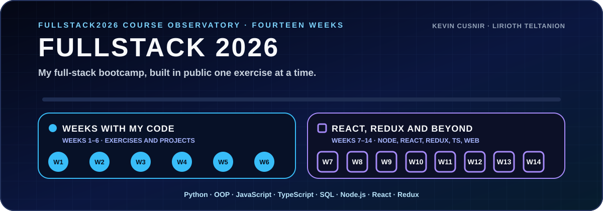
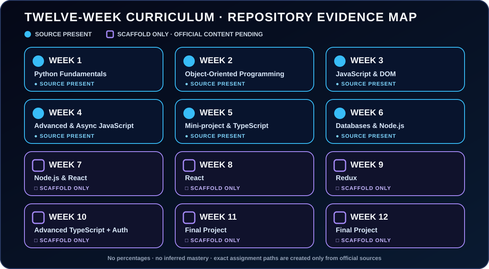
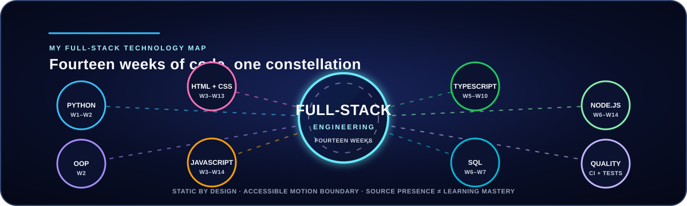

<div align="center">



<br>

[](https://github.com/LiriothTeltanion/Fullstack2026)
[](https://github.com/LiriothTeltanion/Fullstack2026/actions/workflows/quality.yml)
[](https://github.com/LiriothTeltanion/Fullstack2026/commits/main)
[](https://github.com/LiriothTeltanion/Fullstack2026)
[](LICENSE)
[](.learning/course-map.yml)
[](tests/)
[](SECURITY.md)
[](https://kevincusnir.netlify.app)

### My twelve-week full-stack bootcamp: exercises, mini-projects and the tooling that keeps them tidy

**Python · OOP · JavaScript · DOM · Async/Await · TypeScript · SQL · Node.js · React · Redux · Authentication · Final Project**

<sub>Repository presentation version <strong>1.2.0</strong></sub>

</div>

---

## 🧭 Explore the repository

[Overview](#-overview) ·
[Twelve weeks](#-the-twelve-week-journey) ·
[Projects](#-project-highlights) ·
[Stack](#-technology-constellation) ·
[Run](#-quick-start) ·
[Quality](#-quality-and-testing) ·
[Organization](#-repository-organization) ·
[Changelog](CHANGELOG.md)

---

## ✨ Overview

This is the code I write during the Developers Institute full-stack bootcamp. It goes from Python fundamentals to TypeScript, SQL and Node.js, one week and one day at a time.

Weeks 1–6 hold my exercises, XP extensions, daily challenges, timed challenges and mini-projects. Weeks 7–12 have a short README each and fill up as the course reaches them.

Working through the course, I practice how to:

- break problems into small functions and modules;
- improve early solutions without hiding how they started;
- organize code by week, day, exercise type and project;
- keep secrets and generated files out of Git;
- add tests around the projects that matter most;
- run the same checks locally and in GitHub Actions.

The [course map](.learning/course-map.yml) lists every week and day, and the [display map](.learning/display-map.json) holds the readable titles and icons, so the folder names can stay plain ASCII.

---

## 🪐 The twelve-week journey

<div align="center">



</div>

| Week | Topic | Status |
|---|---|---|
| [🐍 Week 1](Week1Python/) | Python Fundamentals | Exercises, challenges and two CLI games, with tests |
| [🏗️ Week 2](Week2OOP/) | Object-Oriented Programming | Classes, modules, files, JSON and APIs, with tests |
| [🌐 Week 3](Week3JavaScriptandDOM/) | JavaScript & DOM | Browser exercises and mini-projects |
| [⚡ Week 4](Week4AdvAsynchronousJavaScript/) | Advanced & Asynchronous JavaScript | Array methods, forms, promises, fetch |
| [🔷 Week 5](Week5MiniProjectAndTypeScript/) | Mini-project & TypeScript | API projects and TypeScript exercises |
| [🗄️ Week 6](Week6DatabasesAndNodejs/) | Databases & Node.js | PostgreSQL queries and Node.js modules |
| [🔗 Week 7](Week7NodejsAndReact/) | Node.js & React | Coming up |
| [⚛️ Week 8](Week8React/) | React | Coming up |
| [🔁 Week 9](Week9Redux/) | Redux | Coming up |
| [🛡️ Week 10](Week10AdvancedTypeScriptAndAuthentication/) | Advanced TypeScript and Authentication | Coming up |
| [🛠️ Week 11](Week11FinalProject/) | Final Project | Coming up |
| [🚀 Week 12](Week12FinalProject/) | Final Project | Coming up |

<details>
<summary><strong>🐍 Week 1 — Python foundations</strong></summary>

| Day | Focus | Folder |
|---|---|---|
| Day 1 | Variables, data types, operators, input/output, conditionals | [Starting with Python](Week1Python/Day1StartingwithPython/) |
| Day 2 | Lists, tuples, sets, loops, formatting | [Lists and iteration](Week1Python/Day2ListsIteratingAndFormattingData/) |
| Day 3 | Dictionaries, nested structures, timed challenges | [Dictionaries](Week1Python/Day3Dictionaries/) |
| Day 4 | Functions, parameters, return values, scope | [Functions](Week1Python/Day4Functions/) |
| Day 5 | Algorithms and command-line mini-projects | [Mini projects](Week1Python/Day5MiniProject/) |

**Highlights:** [Build Up a String](Week1Python/Day1StartingwithPython/DailyChallenge/BuildUpAString/) · [Happy Birthday](Week1Python/Day2ListsIteratingAndFormattingData/DailyChallenge/GoldHappyBirthday/) · [Caesar Cipher](Week1Python/Day3Dictionaries/DailyChallenge/CaesarCypher/) · [Solve the Matrix](Week1Python/Day4Functions/DailyChallenge/SolveTheMatrix/) · [Hangman](Week1Python/Day5MiniProject/Exercises/Hangman/) · [Tic-Tac-Toe](Week1Python/Day5MiniProject/Exercises/TicTacToe/)

</details>

<details>
<summary><strong>🏗️ Week 2 — Object-oriented Python</strong></summary>

| Day | Focus | Folder |
|---|---|---|
| Day 1 | Classes, objects, constructors | [Introduction to OOP](Week2OOP/Day1IntroductiontoOOP/) |
| Day 2 | Inheritance, encapsulation, polymorphism | [Inheritance and polymorphism](Week2OOP/Day2OOPInheritanceEncapsulationPolymorphism/) |
| Day 3 | Modules, packages, properties, dunder methods | [OOP and modules](Week2OOP/Day3OOPandModules/) |
| Day 4 | File I/O, JSON, exceptions, external APIs | [Files, JSON and APIs](Week2OOP/Day4PythonFileIOJSONandAPI/) |
| Day 5 | CLI mini-projects with separated logic | [OOP mini projects](Week2OOP/Day5MiniProject/) |
| Remote | Larger simulations and data models | [Remote OOP work](Week2OOP/RemoteLearningOOP/) |

**Highlights:** [Pagination](Week2OOP/Day2OOPInheritanceEncapsulationPolymorphism/DailyChallenge/Pagination/) · [Circle](Week2OOP/Day3OOPandModules/DailyChallenge/Circle/) · [Text Analysis](Week2OOP/Day4PythonFileIOJSONandAPI/DailyChallenge/TextAnalysis/) · [Anagram Checker](Week2OOP/Day5MiniProject/Exercises/AnagramChecker/) · [Rock Paper Scissors](Week2OOP/Day5MiniProject/Exercises/RockPaperScissors/) · [Weather App](Week2OOP/Day5MiniProject/Exercises/WeatherApp/) · [OOP Quiz](Week2OOP/Day5MiniProject/DailyChallenge/OOPQuiz/) · [Air Management](Week2OOP/RemoteLearningOOP/DailyChallenge/AirManagement/)

</details>

<details>
<summary><strong>🌐 Week 3 — JavaScript and the DOM</strong></summary>

| Day | Focus | Folder |
|---|---|---|
| Day 1 | Syntax, arrays, objects, conditions, loops | [Introduction to JavaScript](Week3JavaScriptandDOM/Day1IntroductiontoJavaScript/) |
| Day 2 | Functions, DOM selection, dynamic rendering | [Functions and DOM](Week3JavaScriptandDOM/Day2FunctionsandDOMIntroduction/) |
| Day 3 | Events, forms, timers, movement | [DOM events](Week3JavaScriptandDOM/Day3LearningDOMEvents/) |
| Day 4 | Advanced functions and higher-order patterns | [Advanced JavaScript](Week3JavaScriptandDOM/Day4AdvancedJavaScriptFunctions/) |
| Day 5 | Interactive browser mini-projects | [Mini projects](Week3JavaScriptandDOM/Day5MiniProject/) |
| Remote | Small browser exercises and games | [Remote JavaScript and DOM](Week3JavaScriptandDOM/RemoteLearningJSAndDOM/) |

**Highlights:** [Solar System](Week3JavaScriptandDOM/Day2FunctionsandDOMIntroduction/DailyChallenge/DailyChallengePlanets/) · [Mad Libs](Week3JavaScriptandDOM/Day3LearningDOMEvents/DailyChallenge/TellTheStory/) · [Todo List](Week3JavaScriptandDOM/Day5MiniProject/DailyChallenge/TodoList/) · [Coloring Game](Week3JavaScriptandDOM/Day5MiniProject/Exercises/MiniProjectColoringGame/) · [Drum Set](Week3JavaScriptandDOM/Day5MiniProject/Exercises/drumset-mini/) · [Whack-a-Mole](Week3JavaScriptandDOM/RemoteLearningJSAndDOM/Exercises/ExercisesXP1/exercise4_whack_a_mole/)

</details>

<details>
<summary><strong>⚡ Week 4 — Advanced and asynchronous JavaScript</strong></summary>

| Day | Focus | Folder |
|---|---|---|
| Day 1 | Advanced array methods | [Advanced array methods](Week4AdvAsynchronousJavaScript/Day1AdvancedArrayMethods/) |
| Day 2 | Object methods, destructuring, classes | [Advanced object methods](Week4AdvAsynchronousJavaScript/Day2AdvancedObjectMethods/) |
| Day 3 | GET/POST forms and JSON | [HTTP and forms](Week4AdvAsynchronousJavaScript/Day3HTTPAndFormMethodGETAndPOST/) |
| Day 4 | Promises and error handling | [Asynchronous JavaScript](Week4AdvAsynchronousJavaScript/Day4AsynchronousJavaScript/) |
| Day 5 | Fetch and async/await | [Fetch and async/await](Week4AdvAsynchronousJavaScript/Day5FetchAndAsyncAwait/) |

**Highlights:** [Car Inventory](Week4AdvAsynchronousJavaScript/Day1AdvancedArrayMethods/DailyChallenge/CarInventory/) · [Go Wildcats](Week4AdvAsynchronousJavaScript/Day1AdvancedArrayMethods/DailyChallenge/GoWildcats/) · [HTML Form](Week4AdvAsynchronousJavaScript/Day3HTTPAndFormMethodGETAndPOST/DailyChallenge/HTMLForm/) · [True or False](Week4AdvAsynchronousJavaScript/Day3HTTPAndFormMethodGETAndPOST/DailyChallenge/TrueOrFalse/) · [Random Quote Generator](Week4AdvAsynchronousJavaScript/Day3HTTPAndFormMethodGETAndPOST/Exercises/RandomQuoteGenerator/) · [Play with Words](Week4AdvAsynchronousJavaScript/Day4AsynchronousJavaScript/DailyChallenge/PlayWithWords/)

</details>

<details>
<summary><strong>🔷 Week 5 — Mini projects and TypeScript</strong></summary>

| Day | Focus | Folder |
|---|---|---|
| Day 1 | API-powered browser projects | [Mini projects](Week5MiniProjectAndTypeScript/Day1MiniProject/) |
| Day 2 | Primitives, unions, typed functions | [TypeScript key concepts](Week5MiniProjectAndTypeScript/Day2IntroductionToTypeScriptAndKeyConcepts/) |
| Day 3 | Interfaces, classes, access modifiers | [Advanced TypeScript applications](Week5MiniProjectAndTypeScript/Day3AdvancedTypeScriptConceptsAndApplications/) |
| Day 4 | Type guards, generics | [Advanced TypeScript guards](Week5MiniProjectAndTypeScript/Day4AdvancedTypeScriptConceptsAndApplications/) |

**Highlights:** [Currency Converter](Week5MiniProjectAndTypeScript/Day1MiniProject/DailyChallenge/CurrencyConverter/) · [Pokédex](Week5MiniProjectAndTypeScript/Day1MiniProject/Exercises/Pokedex/) · [Star Wars Character Finder](Week5MiniProjectAndTypeScript/Day1MiniProject/StarWarsWebApp/) · [Union Type Validator](Week5MiniProjectAndTypeScript/Day2IntroductionToTypeScriptAndKeyConcepts/DailyChallenge/UnionTypeValidator/) · [Library System](Week5MiniProjectAndTypeScript/Day3AdvancedTypeScriptConceptsAndApplications/DailyChallenge/)

</details>

<details>
<summary><strong>🗄️ Week 6 — Databases and Node.js</strong></summary>

| Day | Focus | Folder |
|---|---|---|
| Day 1 | Relational concepts, schemas, SQL basics | [Introduction to databases](Week6DatabasesAndNodejs/Day1IntroductionToDatabases/) |
| Day 2 | Queries, filtering, aggregation | [Database concepts 1](Week6DatabasesAndNodejs/Day2DatabaseConcepts1/) |
| Day 3 | Relationships, joins, constraints (DVD Rental) | [Database concepts 2](Week6DatabasesAndNodejs/Day3DatabaseConcepts2/) |
| Day 4 | CommonJS, ES modules, npm, filesystem | [Node.js introduction](Week6DatabasesAndNodejs/Day4NodejsIntroduction/) |

**Highlights:** [SQL XP](Week6DatabasesAndNodejs/Day1IntroductionToDatabases/Exercises/ExercisesXP/) · [DVD Rental relationships](Week6DatabasesAndNodejs/Day3DatabaseConcepts2/Exercises/ExercisesXP/) · [Node.js and npm challenge](Week6DatabasesAndNodejs/Day4NodejsIntroduction/DailyChallenge/NodejsAppAndNPM/) · [Math app](Week6DatabasesAndNodejs/Day4NodejsIntroduction/Exercises/ExercisesXP/exercise-5-math-app/) · [File explorer](Week6DatabasesAndNodejs/Day4NodejsIntroduction/Exercises/ExercisesXP/exercise-7-file-explorer/)

</details>

---

## 🌟 Project highlights

Every exercise is also on the [live showcase](https://kevincusnir.netlify.app), where the browser projects open as demos.

| Project | Technologies | What I practiced |
|---|---|---|
| [Hangman](Week1Python/Day5MiniProject/Exercises/Hangman/) | Python | Game state, input validation, replayable CLI |
| [Tic-Tac-Toe](Week1Python/Day5MiniProject/Exercises/TicTacToe/) | Python | Board logic, win/tie detection, testable helpers |
| [Circle](Week2OOP/Day3OOPandModules/DailyChallenge/Circle/) | Python OOP | Properties, comparison and arithmetic dunder methods |
| [Page Load Timer](Week2OOP/Day5MiniProject/DailyChallenge/Modules/) | Python, requests | HTTP timing with mocked tests |
| [Coloring Game](Week3JavaScriptandDOM/Day5MiniProject/Exercises/MiniProjectColoringGame/) | HTML, CSS, JavaScript | Event delegation and a drawing grid |
| [Drum Set](Week3JavaScriptandDOM/Day5MiniProject/Exercises/drumset-mini/) | HTML, CSS, JavaScript | Keyboard and mouse input with audio |
| [Random Quote Generator](Week4AdvAsynchronousJavaScript/Day3HTTPAndFormMethodGETAndPOST/Exercises/RandomQuoteGenerator/) | HTML, CSS, JavaScript | Forms, filtering and dynamic rendering |
| [Currency Converter](Week5MiniProjectAndTypeScript/Day1MiniProject/DailyChallenge/CurrencyConverter/) | JavaScript, API | Async data with loading and error states |
| [Pokédex](Week5MiniProjectAndTypeScript/Day1MiniProject/Exercises/Pokedex/) | JavaScript, API | API navigation and data cards |
| [Star Wars Character Finder](Week5MiniProjectAndTypeScript/Day1MiniProject/StarWarsWebApp/) | JavaScript, API | Fetch, response checks, loading animation |
| [Union Type Validator](Week5MiniProjectAndTypeScript/Day2IntroductionToTypeScriptAndKeyConcepts/DailyChallenge/UnionTypeValidator/) | TypeScript | Union types and narrowing |
| [Library System](Week5MiniProjectAndTypeScript/Day3AdvancedTypeScriptConceptsAndApplications/DailyChallenge/) | TypeScript | Interfaces, classes, inheritance |
| [DVD Rental SQL](Week6DatabasesAndNodejs/Day3DatabaseConcepts2/Exercises/ExercisesXP/) | PostgreSQL | Joins, foreign keys, constraints |
| [Node Math App](Week6DatabasesAndNodejs/Day4NodejsIntroduction/Exercises/ExercisesXP/exercise-5-math-app/) | Node.js | Reusable helpers, npm packages, tests |

---

## 🧬 Technology constellation

<p align="center">
  
</p>

| Layer | Technologies and concepts |
|---|---|
| Programming foundations | Python, collections, conditionals, loops, functions, algorithms |
| Object-oriented design | Classes, inheritance, encapsulation, polymorphism, dunder methods |
| Browser | HTML5, CSS3, JavaScript, DOM, events, forms, accessibility |
| Asynchronous code | HTTP, JSON, promises, fetch, async/await |
| Type safety | TypeScript, interfaces, unions, classes, type guards |
| Data | SQL, PostgreSQL, joins, constraints, aggregation |
| Server-side JavaScript | Node.js, CommonJS, ES modules, npm |
| Coming next | React, Redux, advanced TypeScript, authentication, final project |
| Quality and tooling | unittest, Node test runner, ESLint, Prettier, GitHub Actions, Dependabot |

---

## ⚡ Quick start

```powershell
git clone https://github.com/LiriothTeltanion/Fullstack2026.git
cd Fullstack2026
npm ci
```

`npm ci` installs exactly what `package-lock.json` lists, the same way CI does.

```powershell
# Run a Python project
python .\Week1Python\Day5MiniProject\Exercises\TicTacToe\tictactoe.py

# Serve the browser exercises at http://localhost:8000
npm run dev

# PostgreSQL example
psql -d dvdrental -f .\Week6DatabasesAndNodejs\Day3DatabaseConcepts2\Exercises\ExercisesXP\xp_dvdrental_relationships.sql
```

To log the next exercise in my own words, I use the small intake tool (`npm run intake -- add`, or `npm run intake -- next` to see what is queued). It never copies course material. See the [intake guide](.learning/intake/README.md).

---

## 🧪 Quality and testing

| Command | What it does |
|---|---|
| `npm test` | Runs the Python and JavaScript test suites |
| `npm run quality` | Whole-repository check: syntax, JSON, HTML, CSS, links, likely secrets |
| `npm run verify:structure` | Folder structure, catalogs, README visuals and display titles |
| `npm run lint` / `npm run lint:baseline` | ESLint, and a check that the known 65 findings do not grow |
| `npm run typecheck:anchor` | Strict type check of the Union Type Validator project |
| `npm run format` / `npm run format:check` | Prettier for JavaScript and TypeScript |
| `npm run intake:check` | Validates the exercise intake queue |

GitHub Actions ([quality.yml](.github/workflows/quality.yml)) runs these on every push and pull request, and Dependabot keeps npm and Actions dependencies current. The scripts behind the commands are described in [tools/](tools/).

Before committing I run:

```powershell
npm run format:check
npm run lint:baseline
npm run typecheck:anchor
npm run quality
npm test
```

---

## 📁 Repository organization

| Area | Path |
|---|---|
| [⚙️ GitHub Automation and Templates](.github/) | `.github/` |
| [🎓 Course Map and Intake](.learning/) | `.learning/` |
| [🎨 Visual Assets](assets/) | `assets/` |
| [📊 Generated Reports](reports/) | `reports/` |
| [🧪 Automated Tests](tests/) | `tests/` |
| [🛠️ Repository Tools](tools/) | `tools/` |

```text
Fullstack2026/
├─ .github/            workflows and Dependabot
├─ Week1Python/ … Week12FinalProject/
├─ .learning/          course map, display titles, intake queue
├─ assets/readme/      README images
├─ reports/catalog/       generated exercise catalog and file inventory
├─ tests/python/       Python tests
├─ tests/js/           Node tests
└─ tools/              quality and structure scripts
```

Conventions: folder names stay ASCII PascalCase (icons live only in display titles), exercise tiers keep their names (XP, XP Plus, XP Gold, XP Ninja), Python files use `snake_case`, and each change goes on its own branch.

---

## 🔐 Security

- `.env`, `config.js`, API keys and tokens never go into Git; `.env.example` and `config.example.js` are the templates.
- A credential that was ever committed gets rotated right away.
- See the [security policy](SECURITY.md) for reporting a problem.

---

## 🌍 Multilingual summary

<details>
<summary><strong>🇻🇪 Resumen en español</strong></summary>

`Fullstack2026` es mi repositorio del bootcamp full-stack de Developers Institute y la base de mi portafolio. Las semanas 1–6 tienen mis ejercicios y proyectos de Python, programación orientada a objetos, JavaScript, DOM, asincronía, TypeScript, SQL y Node.js. Las semanas 7–12 se van llenando a medida que avanza el curso.

</details>

<details>
<summary><strong>🇮🇱 סיכום בעברית</strong></summary>

`Fullstack2026` הוא המאגר שלי מהבוטקמפ Full-Stack של Developers Institute והבסיס לתיק העבודות שלי. שבועות 1–6 כוללים את התרגילים והפרויקטים שלי ב-Python, תכנות מונחה עצמים, JavaScript, DOM, TypeScript, SQL ו-Node.js. שבועות 7–12 יתמלאו ככל שהקורס מתקדם.

</details>

---

## 👨‍💻 Maintainer

<div align="center">

### Kevin Cusnir · `LiriothTeltanion`

Full-stack development · automation · creative software

Built with AI-assisted tooling; I reviewed, tested and can explain every change.

[](https://github.com/LiriothTeltanion)
[](https://github.com/LiriothTeltanion/Fullstack2026)

</div>

---

## 📜 License

Distributed under the [MIT License](LICENSE).

---

<div align="center">

### Build steadily · document honestly · keep learning

**Fullstack2026 · repository presentation v1.2.0**

</div>
