# 💪 Daily Challenge - TypeScript and React Todo

<div align="center">




</div>

A todo list in React with TypeScript. Every todo follows the `Todo` interface, gets a priority, and the list can be filtered and is sorted with high priority first.

## ▶️ How to run

```bash
npm install
npm run dev
```

## 🎯 The challenge

| Piece | What it does |
|---|---|
| `types.ts` | `Todo`, plus the unions `Priority` (`"low" \| "medium" \| "high"`) and `Filter` |
| `App` | Holds `useState<Todo[]>` and `useState<Filter>`, with `addTodo`, `toggleTodo` and `deleteTodo` |
| `TodoForm` | Text plus a priority select, and calls `onAdd(text, priority)` |
| `TodoList` / `TodoItem` | Typed props with callback types like `(id: number) => void` and a coloured priority dot |

The visible list is filtered, then sorted with a `Record<Priority, number>` rank.

## 🧠 What I learned

- A string union for `Filter` means `setFilter("done")` doesn't compile, so a whole class of typos is gone
- `Record<Priority, string>` forced me to give every priority a colour, and adding a new priority would show me where
- Typing callback props (`onToggle: (id: number) => void`) documents exactly what the parent expects back
- `event.target.value as Priority` is the one cast in the app, and it's safe because the options come from the same list

---

## 👤 Author

**Kevin Cusnir 'Lirioth'**  
Repository: [Fullstack2026](https://github.com/LiriothTeltanion/Fullstack2026)  
Week 10 Day 1 - Using TypeScript with React - Daily Challenge
