# 📦 Source - TypeScript and React Todo

The source code for TypeScript and React Todo.

## Contents

- [`components/`](components/)
- [`App.tsx`](App.tsx)
- [`index.css`](index.css)
- [`main.tsx`](main.tsx)
- [`types.ts`](types.ts)

---

## 👤 Author

**Kevin Cusnir 'Lirioth'**  
Repository: [Fullstack2026](https://github.com/LiriothTeltanion/Fullstack2026)  
Week 10 Day 1 - Using TypeScript with React - Daily Challenge
