# 🧩 Components - TypeScript and React Todo

The React components for TypeScript and React Todo.

## Contents

- [`TodoForm.tsx`](TodoForm.tsx)
- [`TodoItem.tsx`](TodoItem.tsx)
- [`TodoList.tsx`](TodoList.tsx)

---

## 👤 Author

**Kevin Cusnir 'Lirioth'**  
Repository: [Fullstack2026](https://github.com/LiriothTeltanion/Fullstack2026)  
Week 10 Day 1 - Using TypeScript with React - Daily Challenge
