# 🥉 Exercises XP

<div align="center">




</div>

My first React components written in TypeScript. Each exercise types one thing: props, state, an object prop, a list and form events.

## ▶️ How to run

```bash
npm install
npm run dev
```

`npm run typecheck` runs `tsc` on the whole `src` folder without building.

## 🎯 The challenge

1. **Greeting.** `GreetingProps` has a required `name` and an optional `age`, and the age only shows when it is passed.
2. **Counter.** `useState<number>(start)` with a `start` prop that defaults to 0.
3. **UserCard.** Takes a `User` object (from `types.ts`) and an optional `highlight` flag with a default.
4. **UserList.** Renders `User[]`, highlighting mentors.
5. **SignupForm.** `ChangeEvent<HTMLInputElement>`, `ChangeEvent<HTMLSelectElement>` and `FormEvent<HTMLFormElement>`, and an `onAdd` prop typed as `(user: Omit<User, "id">) => void`.

## 🧠 What I learned

- Typing props with an `interface` made the editor list every prop and flag a missing `name` before I ran anything
- `Omit<User, "id">` describes "a user before it has an id" without writing a second interface
- `User["role"]` reuses the union `"student" | "mentor"` for the select's state
- Event types like `FormEvent<HTMLFormElement>` are only needed when the handler is defined outside the JSX; inline handlers get them inferred

---

## 👤 Author

**Kevin Cusnir 'Lirioth'**  
Repository: [Fullstack2026](https://github.com/LiriothTeltanion/Fullstack2026)  
Week 10 Day 1 - Using TypeScript with React - Exercises XP
