# 🧩 Components - Exercises XP

The React components for Exercises XP.

## Contents

- [`Counter.tsx`](Counter.tsx)
- [`Greeting.tsx`](Greeting.tsx)
- [`SignupForm.tsx`](SignupForm.tsx)
- [`UserCard.tsx`](UserCard.tsx)
- [`UserList.tsx`](UserList.tsx)

---

## 👤 Author

**Kevin Cusnir 'Lirioth'**  
Repository: [Fullstack2026](https://github.com/LiriothTeltanion/Fullstack2026)  
Week 10 Day 1 - Using TypeScript with React - Exercises XP
