# 🥇 Exercises XP Gold

<div align="center">




</div>

Three bigger TypeScript patterns in one small app: a reducer with a discriminated union of actions, a typed theme context, and a generic `useLocalStorage<T>` hook.

## ▶️ How to run

```bash
npm install
npm run dev
```

## 🎯 The challenge

1. **Typed `useReducer`.** `shoppingReducer` takes an `Action` union (`added`, `toggled`, `removed`, `clearedBought`). A `never` check in `default` makes the compiler complain if a case is missing. The list is loaded lazily with `useReducer(shoppingReducer, [], loadItems)` and saved on every change.
2. **Typed context.** `ThemeContext` is `createContext<ThemeContextValue | null>(null)`, and `useTheme()` throws when it is used outside `<ThemeProvider>`, so callers never deal with `null`.
3. **Generic hook.** `useLocalStorage<T>(key, initialValue)` reads and writes JSON and returns `[value, setValue] as const`. The theme and the name field both use it.

## 🧠 What I learned

- With a discriminated union, inside `case "toggled"` TypeScript knows `action.id` exists and `action.name` doesn't
- The `const unhandled: never = action` line is a free reminder from the compiler when I add a new action
- `as const` on the hook's return keeps it a tuple, so the value and the setter keep their own types
- Throwing in `useTheme` moves the "is there a provider?" check to one place instead of every component

---

## 👤 Author

**Kevin Cusnir 'Lirioth'**  
Repository: [Fullstack2026](https://github.com/LiriothTeltanion/Fullstack2026)  
Week 10 Day 1 - Using TypeScript with React - Exercises XP Gold
