# 🗃️ State - Exercises XP Gold

The state logic for Exercises XP Gold.

## Contents

- [`shoppingReducer.ts`](shoppingReducer.ts)

---

## 👤 Author

**Kevin Cusnir 'Lirioth'**  
Repository: [Fullstack2026](https://github.com/LiriothTeltanion/Fullstack2026)  
Week 10 Day 1 - Using TypeScript with React - Exercises XP Gold
