# 🥷 Exercises XP Ninja

<div align="center">




</div>

Generic React components in TypeScript. A sortable `DataTable<T>` and a `Select<T>` work with any row type, and a type guard checks JSON data before the table gets it.

## ▶️ How to run

```bash
npm install
npm run dev
```

## 🎯 The challenge

1. **`Column<T>`.** Each column's `key` is `keyof T`, so a typo like `"populaton"` is a compile error. An optional `render(row)` formats a cell.
2. **Sortable `DataTable<T>`.** Clicking a header sorts by that key, and clicking again flips the direction. The header gets `aria-sort` and an arrow.
3. **Type guard.** `isCountry(value: unknown): value is Country` checks every field. `parseCountries` reads `countries.json` as raw text and drops the broken row (one row has `"population": "lots"`).
4. **Generic `Select<T>`.** `onChange` returns a `T` (here a continent), not the string from the DOM.

## 🧠 What I learned

- Writing `function DataTable<T>(...)` lets TypeScript infer `T` from the `rows` prop, so `<DataTable rows={rows} ...>` needs no explicit type
- `value is Country` turns a runtime check into type information, and `data.filter(isCountry)` comes back as `Country[]`
- Data that comes from outside (JSON, an API) should start as `unknown`, not `any`, so I'm forced to check it
- `Select<T>` stores the option's index in the DOM and maps it back to the real option

---

## 👤 Author

**Kevin Cusnir 'Lirioth'**  
Repository: [Fullstack2026](https://github.com/LiriothTeltanion/Fullstack2026)  
Week 10 Day 1 - Using TypeScript with React - Exercises XP Ninja
