# 📦 Source - Exercises XP Ninja

The source code for Exercises XP Ninja.

## Contents

- [`components/`](components/)
- [`data/`](data/)
- [`App.tsx`](App.tsx)
- [`index.css`](index.css)
- [`main.tsx`](main.tsx)

---

## 👤 Author

**Kevin Cusnir 'Lirioth'**  
Repository: [Fullstack2026](https://github.com/LiriothTeltanion/Fullstack2026)  
Week 10 Day 1 - Using TypeScript with React - Exercises XP Ninja
