# 🧩 Components - Exercises XP Ninja

The React components for Exercises XP Ninja.

## Contents

- [`DataTable.tsx`](DataTable.tsx)
- [`Select.tsx`](Select.tsx)

---

## 👤 Author

**Kevin Cusnir 'Lirioth'**  
Repository: [Fullstack2026](https://github.com/LiriothTeltanion/Fullstack2026)  
Week 10 Day 1 - Using TypeScript with React - Exercises XP Ninja
