# 💪 Daily Challenge - Generic Data

<div align="center">




</div>

A generic data component with Redux Toolkit for shared request state. `DataFetcher<T>` loads JSON from a URL, shows loading and error messages, and hands the typed data to a `render` function. The default tab shows recipes and calories per serving from DummyJSON. The same component also shows users, posts and todos from JSONPlaceholder.

## ▶️ How to run

```bash
npm install
npm run dev
```

Needs internet access for `dummyjson.com` and `jsonplaceholder.typicode.com`.

## 🎯 The challenge

| Piece | What it does |
| [types/types.ts](src/types/types.ts) | Shared recipe response, user, post and todo interfaces |
| [api.ts](src/api/api.ts) | Generic fetchData<T>, HTTP status check and optional AbortSignal |
| [dataSlice.ts](src/features/dataSlice.ts) | createAsyncThunk and createSlice for loading, data and errors per URL; request IDs reject stale responses |
| [store.ts](src/store.ts) | configureStore, typed RootState and AppDispatch |

| [main.tsx](src/main.tsx)                | Wraps the application in the Redux Provider                                                                                 |
| --------------------------------------- | --------------------------------------------------------------------------------------------------------------------------- |
| `DataState<T>`                          | Union of `loading`, `error` (with `message`) and `success` (with `data: T`)                                                 |
| [useData<T>(url)](src/hooks/useData.ts) | Dispatches the request, selects its Redux state and aborts it on cleanup                                                    |
| `DataFetcher<T>`                        | Title, Reload button, loading and error text, and `render(state.data)` on success                                           |
| `App`                                   | Four tabs that use `DataFetcher<RecipeResponse>` and `DataFetcher<User[]>`, `DataFetcher<Post[]>` and `DataFetcher<Todo[]>` |

## 🧠 What I learned

- With the `DataState<T>` union, `state.data` only exists after checking `status === "success"`, so I can't render data that isn't there
- Writing `<DataFetcher<Post[]> ...>` in JSX sets `T` explicitly when it can't be inferred from the props
- The abort in the effect cleanup stops a slow answer for the old tab from replacing the new one
- `reload` bumps a counter in the effect dependencies, dispatching another Redux request
- Each URL has its own Redux entry, so users, posts and todos keep separate loading and error states
- `response.json()` is untyped, so the `as Promise<T>` cast is a promise I make, not something TypeScript checks

---

## 👤 Author

**Kevin Cusnir 'Lirioth'**  
Repository: [Fullstack2026](https://github.com/LiriothTeltanion/Fullstack2026)  
Week 10 Day 2 - Mini-project - Daily Challenge
