# 📦 Source - Generic Data

The source code for Generic Data.

## Contents

- [api/](api/), [features/](features/), [types/](types/) and [store.ts](store.ts) provide typed fetches and shared Redux state.

- [`components/`](components/)
- [`hooks/`](hooks/)
- [`App.tsx`](App.tsx)
- [`index.css`](index.css)
- [`main.tsx`](main.tsx)
- [`types.ts`](types.ts)

---

## 👤 Author

**Kevin Cusnir 'Lirioth'**  
Repository: [Fullstack2026](https://github.com/LiriothTeltanion/Fullstack2026)  
Week 10 Day 2 - Mini-project - Daily Challenge
