# 🪝 Hooks - Generic Data

The custom hooks for Generic Data.

## Contents

- [`useData.ts`](useData.ts)

---

## 👤 Author

**Kevin Cusnir 'Lirioth'**  
Repository: [Fullstack2026](https://github.com/LiriothTeltanion/Fullstack2026)  
Week 10 Day 2 - Mini-project - Daily Challenge
