# 🎮 Mini Project - Personal Book

<div align="center">




</div>

My reading list, built around one generic component. `List<T>` renders any array through a `renderItem` function, and the app uses it twice: once for `Book` objects and once for plain author names.

## ▶️ How to run

```bash
npm install
npm run dev
```

## 🎯 The challenge

| Piece | What it does |
|---|---|
| `List<T>` | Props `items: T[]`, `renderItem(item: T)`, `getKey(item: T)` and an optional `emptyText` |
| `Book` / `ReadingStatus` | The book interface and the union `"to read" \| "reading" \| "finished"` |
| `BookForm` | Adds a book through `onAdd(book: Omit<Book, "id" \| "status">)`; genre defaults to "Other" |
| `App` | Status button that cycles with `NEXT_STATUS`, Remove, and the sorted author list |

## Accessible form validation

Title and author are required. Empty or whitespace-only values display an error next to the affected field, associated with it through `aria-describedby`; submission focuses the first invalid field. The form keeps all entered values while errors are corrected. Valid title and author values are trimmed before adding the book, and an omitted genre defaults to "Other". Fields clear only after a valid addition.

## 🧠 What I learned

- A generic component is a normal function component with `<T>` after its name, and TypeScript infers `T` from the props
- Inside `renderItem`, `book` is already typed as `Book`, so autocomplete works without any annotation
- Using the same `List` for strings and for objects showed me why `getKey` is a prop and not hard-coded `item.id`
- A `Record<ReadingStatus, ReadingStatus>` map is a tidy way to write "what comes next"

---

## 👤 Author

**Kevin Cusnir 'Lirioth'**  
Repository: [Fullstack2026](https://github.com/LiriothTeltanion/Fullstack2026)  
Week 10 Day 2 - Mini-project - Mini Project
