# 📦 Source - Recipe Book App

The source code for Recipe Book App.

## Contents

- [model/](model/), [templates/](templates/) and [main.ts](main.ts) implement the class-based DOM entry point.

- [`components/`](components/)
- [`hooks/`](hooks/)
- [`models/`](models/)
- [`App.tsx`](App.tsx)
- [`index.css`](index.css)
- [`main.tsx`](main.tsx)

---

## 👤 Author

**Kevin Cusnir 'Lirioth'**  
Repository: [Fullstack2026](https://github.com/LiriothTeltanion/Fullstack2026)  
Week 10 Day 2 - Mini-project - Mini Project
