# 🧩 Components - Recipe Book App

The React components for Recipe Book App.

## Contents

- [`RecipeCard.tsx`](RecipeCard.tsx)
- [`RecipeForm.tsx`](RecipeForm.tsx)

---

## 👤 Author

**Kevin Cusnir 'Lirioth'**  
Repository: [Fullstack2026](https://github.com/LiriothTeltanion/Fullstack2026)  
Week 10 Day 2 - Mini-project - Mini Project
