# Authentication controllers

- authController.js validates registration, confirms the local email token, logs in, rotates refresh credentials, revokes logout sessions and returns profiles.
- usersController.js preserves the protected user-list exercise and removes hashes through toPublic.

Email confirmation is local practice. Real email delivery is an explicit remaining integration.
