# Access JWT middleware

verifyToken.js reads an explicit bearer credential or the access cookie. It verifies the HS256 algorithm, issuer, audience and access purpose, then checks persistent session state and confirmed user status before allowing the request.
