# 🗄️ Models - Exercises XP

The data access functions for Exercises XP.

## Contents

- [`userModel.js`](userModel.js)

---

## 👤 Author

**Kevin Cusnir 'Lirioth'**  
Repository: [Fullstack2026](https://github.com/LiriothTeltanion/Fullstack2026)  
Week 10 Day 3 - Authentication - Exercises XP
