# API routes

authRoutes.js exposes registration, email confirmation, login, refresh, logout and protected profile routes. Registration, confirmation and login each have a separate limiter. Refresh has its own longer budget.

usersRoutes.js applies verifyToken before the existing user-list endpoint.
