# 🎮 Mini Project - Advanced Functionalities

<div align="center">




</div>

The extra auth features on top of a basic JWT login, written as an Express server in TypeScript: short access tokens with rotating refresh tokens, admin and user roles, a limit on failed logins and stricter password rules.

## ▶️ How to run

```bash
cp .env.example .env   # set the three secrets
npm install
npm run dev            # tsx watch src/server.ts
npm run typecheck      # tsc --noEmit
```

`requests.http` has every call. This is what I got when I ran them against the dev server:

```
POST /auth/register  "short"            → 400 problems: at least 10 characters, at least one number
POST /auth/register  kevin              → 201 role "admin" (first account)
POST /auth/register  maya               → 201 role "user"
GET  /admin/users    as maya            → 403 This needs the role: admin
PATCH /admin/users/1/role {"user"}      → 400 You can't remove your own admin role
PATCH /admin/users/2/role {"admin"}     → 200 maya is now admin
POST /auth/refresh   (first use)        → 200 new token pair
POST /auth/refresh   (same cookie)      → 401 Please log in again
POST /auth/login     6th wrong password → 429 Too many failed logins (Retry-After: 900)
```

## 🎯 The challenge

1. **Access and refresh tokens.** Login and register return a 10-minute access token in the JSON body and set a 7-day refresh token as an httpOnly cookie limited to `path: "/api/auth"`.
2. **Rotation.** Each refresh token has an id (`jti`) stored in `refreshTokens`. `POST /api/auth/refresh` deletes it and issues a new pair, so a refresh token works once. Logout revokes it too.
3. **Roles.** The first account is `admin`, the rest are `user`. `requireRole("admin")` guards `/api/admin/*`, and an admin can't demote themselves.
4. **Login limiter.** `loginLimiter` counts failures per IP and username and answers 429 with `Retry-After` after five within 15 minutes. A successful login clears the count.
5. **Password and username rules.** `checkPassword` and `checkUsername` return every problem at once instead of stopping at the first one.

| File | What it holds |
|---|---|
| `src/tokens.ts` | Creating and checking both kinds of token |
| `src/middleware/auth.ts` | `requireAuth` (Bearer header) and `requireRole(...roles)` |
| `src/middleware/loginLimiter.ts` | The failure counter |
| `src/types.ts` | `Role`, `User`, `TokenUser`, and the `req.user` augmentation for Express |

Users, refresh tokens and login failures live in memory, so a restart clears them.

## 🧠 What I learned

- A short access token limits the damage of a stolen token, and the refresh cookie keeps the user logged in without a new password
- Storing the refresh token ids on the server is what makes logout and rotation real, because a signed JWT alone can't be taken back
- `declare module "express-serve-static-core"` adds `user` to Express's `Request` type, so `req.user` is typed in every route
- Returning `void` and calling `return` after `res.json(...)` keeps the handlers' types clean in strict mode
- Keying the login limiter by IP and username stops guessing on one account without locking out everyone behind the same network
- The refresh cookie travels on its own, so `lusca.csrf()` (with `express-session`) refuses any POST or PATCH that lacks the token from `GET /api/csrf-token` in `x-csrf-token`, and `express-rate-limit` adds 100 requests per 15 minutes per IP (10 for register and login)

---

## 👤 Author

**Kevin Cusnir 'Lirioth'**  
Repository: [Fullstack2026](https://github.com/LiriothTeltanion/Fullstack2026)  
Week 10 Day 4 - TypeScript and Authentication Project - Mini Project
