# 📦 Source - Advanced Functionalities

The source code for Advanced Functionalities.

## Contents

- [`middleware/`](middleware/)
- [`routes/`](routes/)
- [`app.ts`](app.ts)
- [`config.ts`](config.ts)
- [`server.ts`](server.ts)
- [`store.ts`](store.ts)
- [`tokens.ts`](tokens.ts)
- [`types.ts`](types.ts)
- [`validation.ts`](validation.ts)

---

## 👤 Author

**Kevin Cusnir 'Lirioth'**  
Repository: [Fullstack2026](https://github.com/LiriothTeltanion/Fullstack2026)  
Week 10 Day 4 - TypeScript and Authentication Project - Mini Project
