# 🧱 Middleware - Advanced Functionalities

The Express middleware for Advanced Functionalities.

## Contents

- [`auth.ts`](auth.ts)
- [`loginLimiter.ts`](loginLimiter.ts)

---

## 👤 Author

**Kevin Cusnir 'Lirioth'**  
Repository: [Fullstack2026](https://github.com/LiriothTeltanion/Fullstack2026)  
Week 10 Day 4 - TypeScript and Authentication Project - Mini Project
