# 🎮 Mini Project - Collaborative Storytelling App

<div align="center">




</div>

A small full-stack app where people write stories together. You sign up, start a story, invite other users by name, and those contributors can keep writing it. The Express server checks a JWT cookie on every story route, and the React client is written in TypeScript.

## ▶️ How to run

Two terminals, one for each half:

```bash
cd server
cp .env.example .env   # set JWT_SECRET and SESSION_SECRET
npm install
npm run dev            # http://localhost:5000
```

```bash
cd client
npm install
npm run dev            # http://localhost:5173, /api is proxied to the server
```

To try the sharing, register two users in two different browsers (or a private window).

## 🎯 The challenge

**Server** (`server/`, Express + bcrypt + jsonwebtoken)

| Endpoint | Who can use it |
|---|---|
| `POST /api/auth/register`, `/login`, `/logout`, `GET /api/auth/me` | Register also logs in; the JWT (2 h) lives in an httpOnly cookie |
| `GET /api/stories` | Any logged-in user, newest first, with usernames instead of ids |
| `POST /api/stories` | Any logged-in user; they become the author |
| `PATCH /api/stories/:id` | The author and the contributors (403 for anyone else) |
| `DELETE /api/stories/:id` | Only the author |
| `POST /api/stories/:id/contributors` | Only the author; refuses unknown users and people who can already edit |

A run with two users, where noa writes the story and dan is invited later:

```
dan  PATCH  /api/stories/1               → 403 Only the author and contributors can edit this story
noa  POST   /api/stories/1/contributors  → 201 (dan added)
noa  POST   /api/stories/1/contributors  → 409 That user can already edit this story
dan  PATCH  /api/stories/1               → 200 (new content saved)
dan  DELETE /api/stories/1               → 403 Only the author can delete this story
noa  DELETE /api/stories/1               → 204
```

`requireAuth` turns the cookie into `req.user`, and `loadStory` finds the story once (or answers 404) before the controller runs. The data is in memory, so it resets when the server restarts.

**Client** (`client/`, React + TypeScript)

- `api.ts` has one generic `request<T>()` and a typed method per endpoint.
- `App` checks the session with `/api/auth/me` on load, then shows `AuthForm` or the stories.
- `StoryCard` decides from the story data whether to show **Continue the story**, **Delete** and the invite form.

## 🧠 What I learned

- The server decides who may edit; the client only hides buttons, and the 403 answers are what really protect a story
- With the token in an httpOnly cookie and the Vite proxy, the client never handles the token at all
- `request<T>()` gives every call a typed result, so `api.stories()` comes back as `{ stories: Story[] }`
- A small `loadStory` middleware removed the same "find it or 404" block from three controllers
- Reloading the list after each change kept the client simple, at the cost of one extra request
- A cookie login needs CSRF protection: `lusca.csrf()` refuses changes without the token from `GET /api/csrf-token`, so `api.ts` fetches it once and sends it as `x-csrf-token`, and `express-rate-limit` adds 100 requests per 15 minutes per IP (10 for register and login)

---

## 👤 Author

**Kevin Cusnir 'Lirioth'**  
Repository: [Fullstack2026](https://github.com/LiriothTeltanion/Fullstack2026)  
Week 10 Day 4 - TypeScript and Authentication Project - Mini Project
