# 📦 Source - Collaborative Storytelling App

The source code for Collaborative Storytelling App.

## Contents

- [store.ts](store.ts) and [storySlice.ts](storySlice.ts) provide Redux session and story state.
- [types.ts](types.ts) re-exports the [shared API contract](../../shared/types.ts).

- [`components/`](components/)
- [`App.tsx`](App.tsx)
- [`api.ts`](api.ts)
- [`index.css`](index.css)
- [`main.tsx`](main.tsx)
- [`types.ts`](types.ts)

---

## 👤 Author

**Kevin Cusnir 'Lirioth'**  
Repository: [Fullstack2026](https://github.com/LiriothTeltanion/Fullstack2026)  
Week 10 Day 4 - TypeScript and Authentication Project - Mini Project
