# 🖥️ Server - Collaborative Storytelling App

The Express back end for Collaborative Storytelling App.

## Contents

- [db/schema.sql](db/schema.sql) creates PostgreSQL tables; npm run db:setup applies them.
- [models/refreshModel.js](models/refreshModel.js) persists and atomically rotates refresh sessions.
- [routes/contributorRoutes.js](routes/contributorRoutes.js) exposes contributor invite/list/removal routes.

- [`controllers/`](controllers/)
- [`middleware/`](middleware/)
- [`models/`](models/)
- [`routes/`](routes/)
- [`.env.example`](.env.example)
- [`app.js`](app.js)
- [`package.json`](package.json)
- [`server.js`](server.js)
- [`settings.js`](settings.js)

---

## 👤 Author

**Kevin Cusnir 'Lirioth'**  
Repository: [Fullstack2026](https://github.com/LiriothTeltanion/Fullstack2026)  
Week 10 Day 4 - TypeScript and Authentication Project - Mini Project

## Run and deploy

See the [exercise deployment guide](../README.md#hosted-demo-and-reproducible-deployment) for exact repository roots, environment names and same-origin proxy rules. Use `npm ci --omit=dev` and `npm start` for the hosted service; never run schema setup with the runtime credential. `GET /api/health` returns 503 when PostgreSQL is unavailable.

Run `npm ci && npm test` for isolated session persistence tests. The production session store is [sessionStore.js](sessionStore.js); setup-only DDL is in [db/init.js](db/init.js). The runtime queries qualify their schema explicitly for transaction-pooler compatibility.
