# 🧱 Middleware - Collaborative Storytelling App

The Express middleware for Collaborative Storytelling App.

## Contents

- [`loadStory.js`](loadStory.js)
- [`requireAuth.js`](requireAuth.js)

---

## 👤 Author

**Kevin Cusnir 'Lirioth'**  
Repository: [Fullstack2026](https://github.com/LiriothTeltanion/Fullstack2026)  
Week 10 Day 4 - TypeScript and Authentication Project - Mini Project
