# 🗄️ Models - Collaborative Storytelling App

The data access functions for Collaborative Storytelling App.

## Contents

- [`db.js`](db.js)
- [`storyModel.js`](storyModel.js)
- [`userModel.js`](userModel.js)

---

## 👤 Author

**Kevin Cusnir 'Lirioth'**  
Repository: [Fullstack2026](https://github.com/LiriothTeltanion/Fullstack2026)  
Week 10 Day 4 - TypeScript and Authentication Project - Mini Project
