# 🧪 Remote Exercise - Authentication and TypeScript Project

<div align="center">




</div>

Sign up, log in and edit a protected profile. The Express server hands out a JWT that the client sends in the `Authorization` header, and the React side keeps the session in a typed `AuthContext`.

## ▶️ How to run

```bash
cd server
cp .env.example .env   # set JWT_SECRET
npm install
npm run dev            # http://localhost:5000
```

```bash
cd client
npm install
npm run dev            # http://localhost:5173, /api goes to the server
```

## 🎯 The challenge

**Server** (`server/`)

| Endpoint | What it does |
|---|---|
| `POST /api/auth/register` | Name, email and an 8+ character password; bcrypt hash; answers `{ token, user }` |
| `POST /api/auth/login` | Checks the password and answers `{ token, user }` (1 hour token) |
| `GET /api/profile` | Protected by `authenticate`, which reads `Authorization: Bearer <token>` |
| `PUT /api/profile` | Updates `name` and `bio` (cut to 280 characters) |

A quick run against the dev server:

```
POST /api/auth/register  (bad email)       → 400 Please enter a valid email
GET  /api/profile        (no header)       → 401 Missing token
GET  /api/profile        (Bearer <token>)  → 200 {"user":{"id":1,"name":"Kevin",...}}
GET  /api/profile        (made-up token)   → 401 Token expired or invalid
```

**Client** (`client/`, React + TypeScript)

| Piece | What it does |
|---|---|
| `api.ts` | Generic `request<T>()` and an `ApiError` class that keeps the HTTP status |
| `AuthContext` | `user`, `token`, `loading`, `login`, `register`, `logout`; checks a saved token with `/api/profile` on load |
| `RequireAuth` | Shows its children to a logged-in user, or the `fallback` (the login page) |
| `AuthPage` / `ProfilePage` | One form that switches between log in and sign up, and the profile editor |

The token is kept in `sessionStorage`, so it survives a refresh and is gone when the tab closes. A page script could still read it, which is the trade-off against the httpOnly cookie I used in the Day 4 project.

## 🧠 What I learned

- Sending the token in a header means the client has to store it somewhere, and that choice decides how exposed it is
- `ApiError` with a `status` field let the context log out only on a real 401, not on a network hiccup
- Typing the context value as an interface made `useAuth()` give full autocomplete for `login`, `logout` and `user`
- `RequireAuth` keeps the "is anyone logged in?" check in one component instead of in every page

---

## 👤 Author

**Kevin Cusnir 'Lirioth'**  
Repository: [Fullstack2026](https://github.com/LiriothTeltanion/Fullstack2026)  
Week 10 Remote Learning - Authentication and TypeScript - Remote Exercise
