# 💻 Client - Authentication and TypeScript Project

The React front end for Authentication and TypeScript Project.

## Contents

- [`src/`](src/)
- [`index.html`](index.html)
- [`package.json`](package.json)
- [`tsconfig.json`](tsconfig.json)
- [`vite.config.ts`](vite.config.ts)

---

## 👤 Author

**Kevin Cusnir 'Lirioth'**  
Repository: [Fullstack2026](https://github.com/LiriothTeltanion/Fullstack2026)  
Week 10 Remote Learning - Authentication and TypeScript - Remote Exercise
