# 🛣️ Routes - Authentication and TypeScript Project

The Express routers for Authentication and TypeScript Project.

## Contents

- [`authRoutes.js`](authRoutes.js)
- [`profileRoutes.js`](profileRoutes.js)

---

## 👤 Author

**Kevin Cusnir 'Lirioth'**  
Repository: [Fullstack2026](https://github.com/LiriothTeltanion/Fullstack2026)  
Week 10 Remote Learning - Authentication and TypeScript - Remote Exercise
