# 🛰️ Remote Learning — Authentication and TypeScript

Authentication and TypeScript. Nothing is done here yet; each folder below is ready for my code.

## Contents

- [`Exercises/`](Exercises/)

---

## 👤 Author

**Kevin Cusnir 'Lirioth'**  
Repository: [Fullstack2026](https://github.com/LiriothTeltanion/Fullstack2026)  
Week 10 Remote Learning - Authentication and TypeScript
