# 📝 Final Project Scope

Ivrit Sheli is a Hebrew-learning product. [The proposed module](SCOPE.md) describes a PERN vocabulary review feature, its acceptance checks and its relationship to the existing application.

## ▶️ How to run

Open [the scope](SCOPE.md) for the proposed user journey, data model and implementation milestones.

## 🎯 The challenge

| Design question | Where to find the answer |
|---|---|
| What already exists? | Existing work and proposed course contribution |
| What would the learner do? | User stories, acceptance checks and screen flow |
| How would the module be verified? | Data model, acceptance checks and delivery evidence |

## 🧠 What I learned

- Writing "done when…" next to each feature turns a vague idea into something I can check
- An explicit out-of-scope list protects the deadline more than any extra feature
- Sketching tables and endpoints before coding shows early whether the idea fits the PERN stack
- Planning a deploy on day 2 avoids discovering hosting problems the night before the demo

---

## 👤 Author

**Kevin Cusnir 'Lirioth'**  
Repository: [Fullstack2026](https://github.com/LiriothTeltanion/Fullstack2026)  
Week 11 Day 1 - Final Project Scope - Final Project Scope
