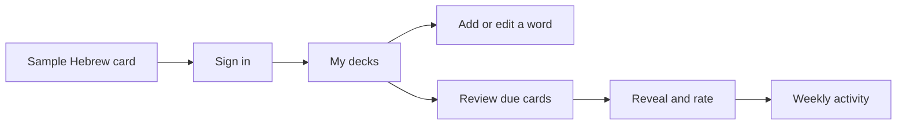

# Ivrit Sheli | A Hebrew vocabulary review session

An adult learning Hebrew in Israel can save a useful word, enter its translation in Spanish or English, and practise it again when the next review is due. Hebrew entries read right to left while translations keep their own text direction.

## Existing work and proposed course contribution

[Ivrit Sheli 2.13.0](https://github.com/LiriothTeltanion/IvritSheli/tree/929f925f9494b646b17827809265e5596833ce5b) already has a React interface, a Python/FastAPI backend, learning scenes and local-first progress. This proposal discloses that starting point. The course contribution would be an independently demonstrable vocabulary deck and review flow using React, Node.js, Express and PostgreSQL. The Week 12 folder currently contains a generic PERN starter.

## What a learner can do

| User story | Acceptance check |
|---|---|
| As a visitor, I want to understand a word card before signing up. | A sample card displays a Hebrew word, optional transliteration and a Spanish or English translation. |
| As a learner, I want my own collection. | I can create an account, sign in, create or rename a deck, and add, edit, filter or delete a card. A second account can access only its own decks. |
| As a learner, I want to practise words I have difficulty recalling. | A session selects due cards. Revealing the answer and choosing a recall rating records one review and sets the next due time. |
| As a returning learner, I want to see what I practised. | The dashboard shows the last seven days of reviews and the number of cards currently due. |

The first demonstration uses synthetic vocabulary and two test accounts. Playback, CSV import and richer learning statistics are possible extensions. The proposed deliverable fits one learner working with their own decks.

## Data, routes and screen flow

| PostgreSQL table | Responsibility |
|---|---|
| users | Account ID, unique email, password hash and creation time. |
| decks | Owner and deck title. |
| cards | Deck, Hebrew, transliteration, translation, target language, review interval and next due time. |
| reviews | Card, rating and timestamp. A review and the card's updated schedule are written in one transaction. |

The proposed API has register and login routes, authenticated deck and card CRUD, a due-card query and a review submission. Ownership follows each card through its deck. A repeated review request should produce a single event. Writing the next review date in UTC allows tests to use a fixed clock.

## Implementation plan

| Milestone | Technical evidence |
|---|---|
| Establish the existing product baseline | Versioned feature inventory and a bounded vocabulary review design. |
| Define the model and build the API | Schema, seed data and repeatable tests for account isolation and review scheduling. |
| Build the client | Keyboard-accessible review with Hebrew RTL, English/Spanish text and useful empty states. |
| Rehearse and deploy | Live URL for the deployed version, a short demo with synthetic data and an explanation of one scheduling decision. |

React and TypeScript would drive the screens. Express and Node.js would expose the API, with PostgreSQL storing the learner's collection. Render is the proposed host, subject to a suitable course deployment being available. The review rule can use a small, documented interval table so each rating is explainable and testable.

## Delivery evidence

The proposed release includes a reproducible setup, synthetic seed data, an accessible deployed review flow, a short product demonstration and a technical walkthrough of ownership and scheduling.
