# 📝 Day 1 — Final Project Scope

Final Project Scope. Nothing is done here yet; each folder below is ready for my code.

## Contents

- [`ProjectScope/`](ProjectScope/): Final Project Scope: to do (required)

---

## 👤 Author

**Kevin Cusnir 'Lirioth'**  
Repository: [Fullstack2026](https://github.com/LiriothTeltanion/Fullstack2026)  
Week 11 Day 1 - Final Project Scope
