# 🛠️ Week 11 — Final Project

Week 11 is for the final project. The brief has not been published yet.

## Contents

Nothing yet. The project will live here with its own README, source code, tests and docs once the brief is out. I will credit anyone who contributes.

---

## 👤 Author

**Kevin Cusnir 'Lirioth'**  
Repository: [Fullstack2026](https://github.com/LiriothTeltanion/Fullstack2026)  
Week 11 - Final Project
