# 🏁 Capstone Project

<div align="center">




</div>

The starter for my capstone: a PERN skeleton with an Express API in `server/` and a React client in `client/`, already connected end to end through one example resource (`items`). I rename `items` to my project's main resource and grow it from there.

## ▶️ How to run

1. Create a PostgreSQL database called `capstone` and load the starter table:

```bash
psql -U postgres -d capstone -f server/db/schema.sql
```

2. Start the API (copy `server/.env.example` to `server/.env` first and set `DATABASE_URL`):

```bash
cd server
npm install
npm run dev
```

3. Start the client in a second terminal:

```bash
cd client
npm install
npm run dev
```

Vite forwards `/api` to `http://localhost:5000`. I checked the API without a database running, which shows the error paths:

```
GET  /api/health  -> {"status":"ok","database":"not connected (ECONNREFUSED)"}
POST /api/items {} -> 400 {"error":"Title is required."}
GET  /api/nope    -> 404 {"error":"No route for GET /api/nope"}
```

The CRUD routes need PostgreSQL running to answer with data.

## 🎯 The challenge

| Part | What it does |
|---|---|
| `server/server.js` | Express app with CORS limited to `CLIENT_URL`, JSON body parsing, `GET /api/health`, the items router and the two error middlewares |
| `server/db/index.js` | One `pg.Pool` from `DATABASE_URL`, a `query()` helper and `checkConnection()` |
| `server/db/schema.sql` | Creates the `items` table and inserts three starter rows |
| `server/models/itemsModel.js` | All SQL for items, with `$1` parameters: `findAll`, `create`, `toggle`, `remove` |
| `server/controllers/itemsController.js` | Validates input, calls the model, answers 201/204/400/404 and passes surprises to `next(error)` |
| `server/routes/items.js` | `GET /`, `POST /`, `PATCH /:id/toggle`, `DELETE /:id` |
| `server/middleware/` | `notFound` (404 JSON) and `errorHandler` (500 JSON, error logged on the server) |
| `client/src/api.js` | One `request()` wrapper around `fetch` that throws the API's error message |
| `client/src/App.jsx` | Loads the items and adds, toggles and deletes them through `ItemForm` and `ItemList` |

## 🧠 What I learned

- Splitting routes, controllers and models means each file answers one question: where, what, and which SQL
- Parameterized queries (`$1`) keep user input out of the SQL string
- A health route that also pings the database tells me in one request which half is down
- The client never needs a full URL thanks to the Vite proxy, which also makes deploying behind one domain easier

---

## 👤 Author

**Kevin Cusnir 'Lirioth'**  
Repository: [Fullstack2026](https://github.com/LiriothTeltanion/Fullstack2026)  
Week 12 Day 1 - Capstone Submission - Capstone Project
