# 💻 Client - Capstone Project

The React front end for Capstone Project.

## Contents

- [`src/`](src/)
- [`index.html`](index.html)
- [`package.json`](package.json)
- [`vite.config.js`](vite.config.js)

---

## 👤 Author

**Kevin Cusnir 'Lirioth'**  
Repository: [Fullstack2026](https://github.com/LiriothTeltanion/Fullstack2026)  
Week 12 Day 1 - Capstone Submission - Capstone Project
