# 🖥️ Server - Capstone Project

The Express back end for Capstone Project.

## Contents

- [`controllers/`](controllers/)
- [`db/`](db/)
- [`middleware/`](middleware/)
- [`models/`](models/)
- [`routes/`](routes/)
- [`.env.example`](.env.example)
- [`package.json`](package.json)
- [`server.js`](server.js)
- [`tests/`](tests/) - dependency-free item-title regression tests.

## Validation and tests

`POST /api/items` requires a string title containing 1–120 Unicode characters after trimming surrounding whitespace. Invalid titles return HTTP 400 before the database is called; internal whitespace and Unicode text are preserved.

Run `npm test` in this directory for the title-validation regression. The same cases run through the repository's normal JavaScript test command. These dependency-free handler tests do not require a running PostgreSQL instance.

---

## 👤 Author

**Kevin Cusnir 'Lirioth'**  
Repository: [Fullstack2026](https://github.com/LiriothTeltanion/Fullstack2026)  
Week 12 Day 1 - Capstone Submission - Capstone Project
