# 🎛️ Controllers - Capstone Project

The request handlers for Capstone Project.

## Contents

- [`itemsController.js`](itemsController.js)
- [`createItemHandler.js`](createItemHandler.js) - validates titles before invoking persistence.

---

## 👤 Author

**Kevin Cusnir 'Lirioth'**  
Repository: [Fullstack2026](https://github.com/LiriothTeltanion/Fullstack2026)  
Week 12 Day 1 - Capstone Submission - Capstone Project
