# 🗄️ Database - Capstone Project

The database connection and helpers for Capstone Project.

## Contents

- [`index.js`](index.js)
- [`schema.sql`](schema.sql)

---

## 👤 Author

**Kevin Cusnir 'Lirioth'**  
Repository: [Fullstack2026](https://github.com/LiriothTeltanion/Fullstack2026)  
Week 12 Day 1 - Capstone Submission - Capstone Project
