# 🏁 Day 1 — Capstone Submission

The starter code for my capstone: an Express API and a React client.

## Contents

- [`CapstoneProject/`](CapstoneProject/): Capstone Project: PERN starter with an Express API and a React client

---

## 👤 Author

**Kevin Cusnir 'Lirioth'**  
Repository: [Fullstack2026](https://github.com/LiriothTeltanion/Fullstack2026)  
Week 12 Day 1 - Capstone Submission
