# 🎤 Demo Day

My Demo Day outline: a 5-minute talk built around a live demo of the capstone. [`PRESENTATION.md`](PRESENTATION.md) holds the timing, the content of each slide, a checklist for the day and short answers to likely questions.

## ▶️ How to run

I open [`PRESENTATION.md`](PRESENTATION.md), fill in each `_…_` line with my project's details, build the slides from the eight sections and rehearse with a timer until the talk fits in 5 minutes.

## 🎯 The challenge

| Part | What it covers |
|---|---|
| Timing table | 30 s hook and problem, 20 s solution, 2:30 live demo, 1 min stack and one hard part, 30 s learnings, 10 s thanks |
| Slides 1–3 | Hook, the problem and the solution with the live and GitHub links |
| Slide 4 | The demo as one user story from start to end, with a demo account and a backup recording |
| Slides 5–6 | The PERN diagram and one real problem I solved, with a snippet |
| Slides 7–8 | What I learned, the next feature and my contact links |
| Checklist | Server up, demo data ready, zoom and notifications set, charger packed |
| Questions | Short answers for why this project, password storage, next steps and teamwork |

## 🧠 What I learned

- Half of the time goes to the demo, because showing the app convinces more than describing it
- One user story from start to end is easier to follow than a tour of every button
- A recorded backup turns a network failure into a 60-second detour instead of a dead stop
- Preparing answers to the obvious questions keeps the Q&A calm

---

## 👤 Author

**Kevin Cusnir 'Lirioth'**  
Repository: [Fullstack2026](https://github.com/LiriothTeltanion/Fullstack2026)  
Week 12 Day 5 - Demo Day - Demo Day
