# 🎤 Day 5 — Demo Day

Demo Day. Nothing is done here yet; each folder below is ready for my code.

## Contents

- [`DemoDayPresentation/`](DemoDayPresentation/): Demo Day: to do (optional)

---

## 👤 Author

**Kevin Cusnir 'Lirioth'**  
Repository: [Fullstack2026](https://github.com/LiriothTeltanion/Fullstack2026)  
Week 12 Day 5 - Demo Day
