# 🚀 Week 12 — Final Project

The capstone starter and my Demo Day presentation. 2 exercises in total.

## Contents

| Folder | Topic | Required | Optional |
|---|---|---:|---:|
| [`Day1CapstoneSubmission/`](Day1CapstoneSubmission/) | Capstone Submission | 1 | 0 |
| [`Day5DemoDay/`](Day5DemoDay/) | Demo Day | 0 | 1 |

---

## 👤 Author

**Kevin Cusnir 'Lirioth'**  
Repository: [Fullstack2026](https://github.com/LiriothTeltanion/Fullstack2026)  
Week 12 - Final Project
