# 💪 Daily Challenge - Avengers

<div align="center">




</div>

A fan page with one card for each of the six original Avengers: hero name, real name, a one-line bio and their power. All the cards share one set of rules, and each gets its own color from a single custom property, `--hero`, set inline in [index.html](index.html).

## ▶️ How to run

No build step. Open [index.html](index.html) in a browser, or serve the folder:

```bash
python -m http.server 8000
```

For a live link I can drag this folder onto Netlify Drop.

## 🎯 The challenge

1. **Banner.** A striped background made with `repeating-linear-gradient`, a red glow on top of it, and a title with a hard red `text-shadow`.
2. **Team grid.** `ul.team` is a flex container with `flex-wrap: wrap`. Each card is `flex: 1 1 280px`, so a laptop shows three per row and a phone shows one.
3. **Cards.** The round emblem is a `span` centered with `display: grid; place-items: center`. The top border, the emblem and the "Power" tag all read `var(--hero)`.
4. **Motion.** Hovering lifts a card with `transform: translateY(-6px)`. Inside `@media (prefers-reduced-motion: reduce)` the transition and the lift are switched off.

## 🧠 What I learned

- A custom property on each card (`style="--hero: #c62828"`) let six cards look different with one CSS rule
- `flex: 1 1 280px` means grow, shrink and start at 280px, and that line alone made the layout responsive
- The emblems only repeat the initials, so they get `aria-hidden="true"` and the `h2` carries the name
- My first Black Widow color was almost black and vanished on the dark card, so I switched to a grey-blue

---

## 👤 Author

**Kevin Cusnir 'Lirioth'**  
Repository: [Fullstack2026](https://github.com/LiriothTeltanion/Fullstack2026)  
Week 13 Day 1 - HTML and CSS - Daily Challenge
