# 🐾 The domestic cat and the lion

<div align="center">




</div>

A semantic HTML article about the characteristics and behavior of domestic cats and lions. An internal link moves to the lion section, and a comparison table connects the two animals through shared traits and different habits.

## ▶️ Open the pages

Open [index.html](index.html) directly, or serve this directory.

```bash
python -m http.server 8000 --bind 127.0.0.1
```

Visit `http://127.0.0.1:8000/` for the article and `http://127.0.0.1:8000/about.html` for the preserved original page.

## 🧩 Page structure

| File | Purpose |
| --- | --- |
| [index.html](index.html) | Domestic cat and lion sections, local navigation and the comparison table |
| [cats.css](cats.css) | Responsive article layout layered over the original paper theme |
| [style.css](style.css) | Original shared typography, colors and basic page layout |
| [about.html](about.html) | The original About me HTML, preserved byte for byte |
| [about-README.md](about-README.md) | Earlier explanation and reflections, with its opening link updated to the preserved page |

The article uses named sections and native links. The lion anchor is `#lion`. The table has a caption, column headers and row headers with explicit scope. All text, anchors and table relationships are available without CSS or JavaScript. The page uses local styles and system fonts, with no external image, font or script requests.

## 🧪 Manual checks

- At desktop, 375 px and 320 px widths, read both animal sections and the full comparison table.
- Navigate with Tab and Enter, including Skip to content, Jump to the lion and the link to the original page.
- Disable styles and confirm the heading order, lion link and table headers remain usable.
- Open about.html and check the original content and style still load.

## 👤 Author

Kevin Cusnir · [Fullstack2026](https://github.com/LiriothTeltanion/Fullstack2026)

AI-assisted implementation and browser testing.
