# 🧪 Exercise - First HTML Page

My first page written by hand, from the doctype down to the footer. It's a short "about me" with headings, two kinds of lists, a quote, a table and a link. The only picture is an inline SVG badge with my initials, so the folder needs no image files.

## ▶️ How to run

Double-click [about.html](about.html), or run `python -m http.server 8000` here and open `http://localhost:8000/about.html`.

## 🎯 The challenge

| Part | What I used |
|---|---|
| Page skeleton | `header`, `main` with five `section`s, `footer`, and a "Skip to content" link |
| About me | An inline `svg` inside a `figure` with a `figcaption`, floated right |
| What I've learned | An ordered list `ol` |
| Music I code to | An unordered list `ul` and a `blockquote` with its own small footer |
| HTML tags table | `table` with `caption`, `thead`, `th scope="col"` and `tbody` |
| Find me | An external link with `target="_blank"` and `rel="noopener noreferrer"` |

[style.css](style.css) gives it a light "paper" look: a cream background, white sections with rounded corners and a serif font.

## 🧠 What I learned

- Each `section` has `aria-labelledby` pointing at its own `h2`, so screen readers announce real section names
- A `caption` names the table, and `scope="col"` tells the browser which cells are headers
- A floated badge sticks out of its section, so a `::after` with `clear: both` closes each section below it
- `width: min(720px, 100% - 2rem)` keeps the text readable on a wide screen and still leaves a gap on a phone

---

## 👤 Author

**Kevin Cusnir 'Lirioth'**

Repository: [Fullstack2026](https://github.com/LiriothTeltanion/Fullstack2026)

Week 13 Day 1 - HTML and CSS - Exercise
