# 🧪 Exercise - Landing Page

A landing page for Practice Pulse, a practice timer for musicians that I made up for this page. It has a navigation bar, a hero with a fake timer card, three features, a "how it works" strip and two price plans, all laid out with Flexbox and no grid.

## ▶️ How to run

Open [index.html](index.html) in a browser. It's two static files, so dropping the folder on Netlify Drop is enough to put it online.

## 🎯 The challenge

1. **Nav.** `display: flex` with `justify-content: space-between` puts the logo on the left and the links on the right. `flex-wrap` lets the links drop under the logo on a phone.
2. **Hero.** Two flex items: the text (`flex: 1 1 420px`) and the timer card (`flex: 1 1 280px`). The card holds a small bar chart: seven `span`s in a flex row with `align-items: flex-end`, each with its height in a `--h` variable.
3. **Features and plans.** Cards with `flex: 1 1 250px` that wrap on their own. The featured plan gets a pink border.
4. **Steps.** An `ol` with `counter-reset` and `counter-increment`, so the numbers come from CSS `::before`.
5. **Dark theme.** Colors live in `:root` variables, the page background is a `radial-gradient`, and smooth scrolling and hover lifts turn off under `prefers-reduced-motion`.

## 🧠 What I learned

- `flex: 1 1 <width>` plus `flex-wrap: wrap` gives a responsive row of cards without a single media query
- A bar chart can be plain `span`s with `align-items: flex-end` and a percentage height
- CSS counters number the steps for me, so reordering the list keeps the numbers right
- `scroll-behavior: smooth` is nice for the nav links, but it belongs inside the reduced-motion check

---

## 👤 Author

**Kevin Cusnir 'Lirioth'**  
Repository: [Fullstack2026](https://github.com/LiriothTeltanion/Fullstack2026)  
Week 13 Day 1 - HTML and CSS - Exercise
